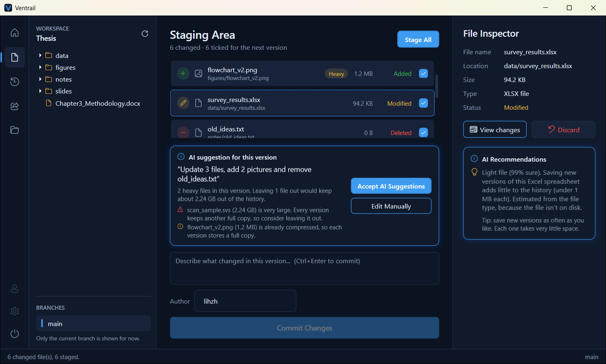
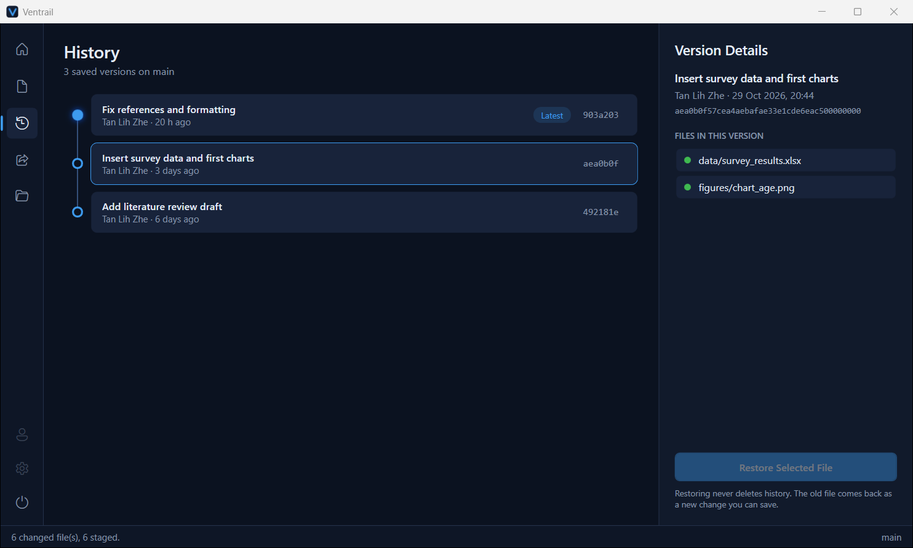
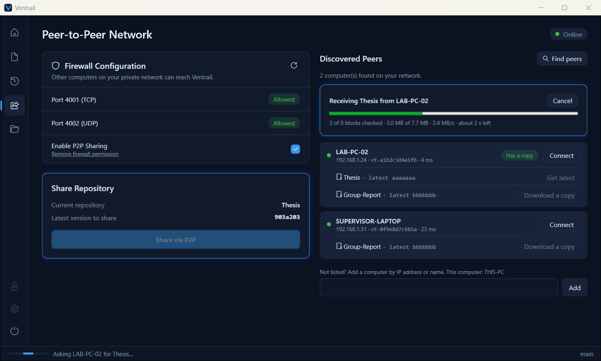

# Ventrail

**Version control for people who don't use Git**: keep every version of your thesis, designs or
research data, get offline AI advice on what to save, and share versions directly with computers
on the same network. No account, no cloud, no command line.

*Capstone Project 2, Sunway University, by Tan Lih Zhe.*
Windows desktop app: C# · .NET 8 · WPF (MVVM) · LibGit2Sharp · ML.NET · TCP/UDP sockets with a
Kademlia DHT.



## Features

- **Save versions without Git knowledge.** Pick a folder, tick the changed files and describe
  the change.
  - Restore any old file at any time, without history ever being rewritten.
  - Discard changes, with a safety copy kept in the Recycle Bin.
  - Line-by-line diff view.
- **Offline AI storage advisor.** An ML.NET model (99.9 % accuracy on held-out data) flags
  *heavy* files that would bloat the history.
  - It writes the commit message for you and suggests leaving out huge files.
  - It runs entirely on the PC.
- **Peer-to-peer sharing on the local network.**
  - Finds other computers by LAN broadcast plus a Kademlia DHT.
  - Downloads a copy, or gets the latest version, in 1 MB blocks, each checked by SHA-256.
  - Resumes after interruptions, and never overwrites your work.
- **Safe networking.**
  - A read-only firewall audit, then one clearly explained Windows prompt.
  - Rules are limited to Ventrail, its two ports and the local network.
  - Waiting times adapt to each peer's measured round-trip time and speed.

| History | Peer-to-peer |
|---|---|
|  |  |

## Try it

**Users:** download `Ventrail-1.0.0-win-x64.zip`, unzip it and run `Ventrail.exe`. .NET does not
need to be installed. See the **[user guide](docs/USER_GUIDE.md)**.

**Developers** (Windows, the .NET 8 SDK or newer, and an up-to-date Visual Studio 2022, which
opens the `Ventrail.slnx` solution):

```
git clone https://github.com/LihZheTan/Ventrail.git
cd Ventrail
dotnet run --project Ventrail -- --demo
```

`--demo` shows made-up data and never touches real files, the firewall or the network. In Visual
Studio, choose the **Ventrail (Demo data)** launch profile in the ▼ next to the green ▶ button.

## Tests

```
powershell -ExecutionPolicy Bypass -File tests\run-all.ps1
```

This runs 296 checks in 7 suites, up to an end-to-end run of two real nodes on slow, frozen and
busy networks. See [tests/README.md](tests/README.md).

## Build a release

```
powershell -ExecutionPolicy Bypass -File build\package.ps1
```

This runs the tests, publishes a self-contained build and zips it into `artifacts\`. If
[Inno Setup 6](https://jrsoftware.org/isinfo.php) is installed, it also builds `Ventrail-1.0.0-Setup.exe`
from [installer/Ventrail.iss](installer/Ventrail.iss).

## Repository layout

| Path | Contents |
|---|---|
| `Ventrail/` | The app: `Views/` (XAML), `ViewModels/`, `Services/` (Git, AI, network), `Models/` |
| `Ventrail.ModelTrainer/` | Offline trainer for the ML.NET classifier, with its dataset and metrics report |
| `tests/` | Headless test suites and `run-all.ps1` |
| `build/`, `installer/` | Release packaging |
| `docs/` | [User guide](docs/USER_GUIDE.md), [architecture](docs/ARCHITECTURE.md), screenshots |
| `DEVLOG.md` | Week-by-week development log: what was built, tested, decided and found |

## Licence and credits

Built on [LibGit2Sharp](https://github.com/libgit2/libgit2sharp) (MIT),
[ML.NET](https://github.com/dotnet/machinelearning) (MIT) and
[CommunityToolkit.Mvvm](https://github.com/CommunityToolkit/dotnet) (MIT).
Academic project. All rights reserved by the author unless stated otherwise.
