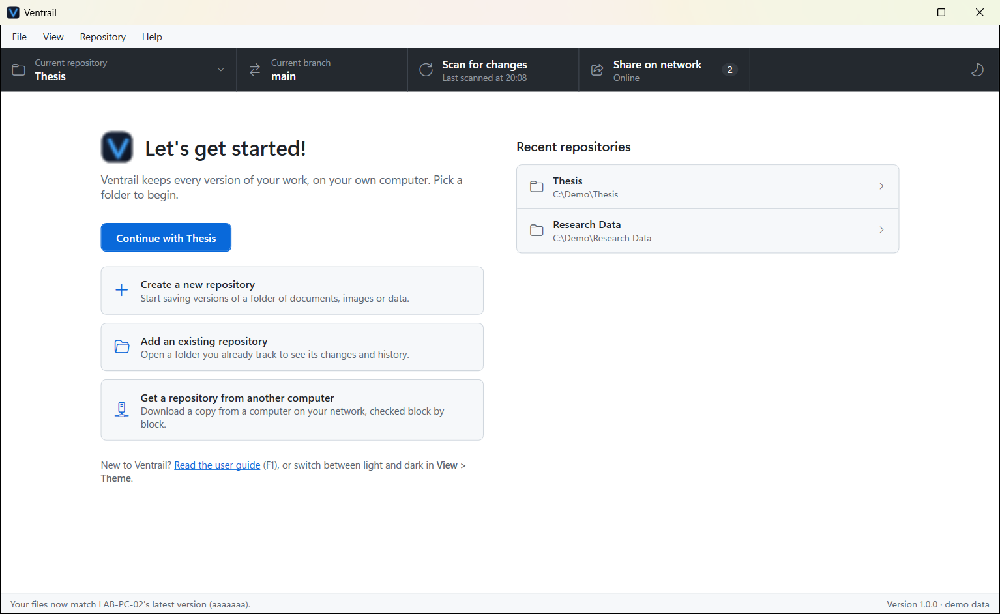
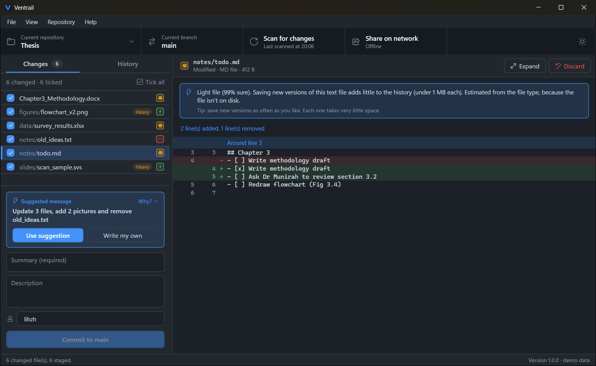
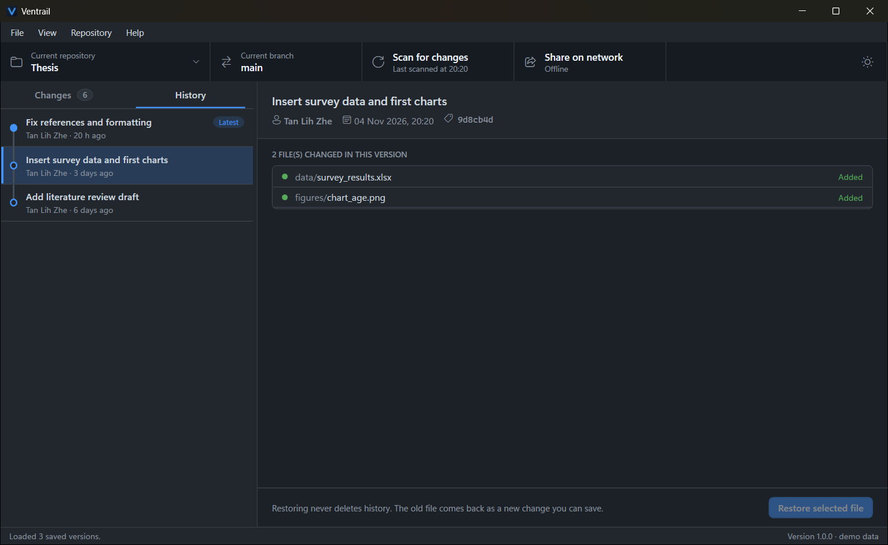
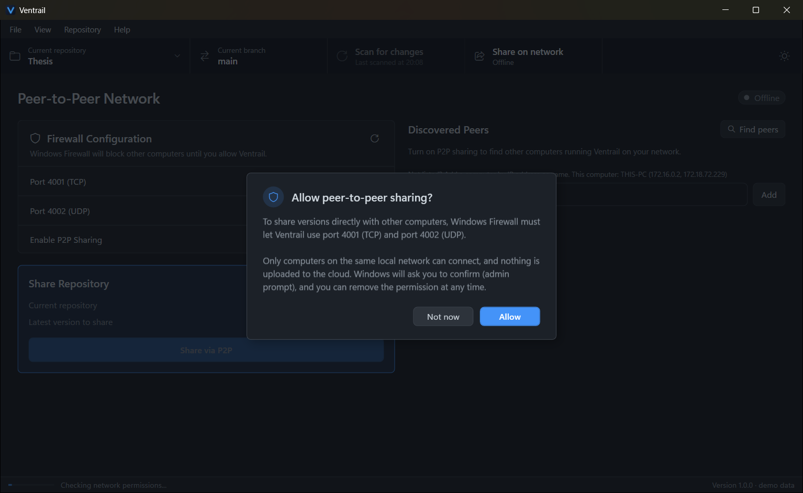
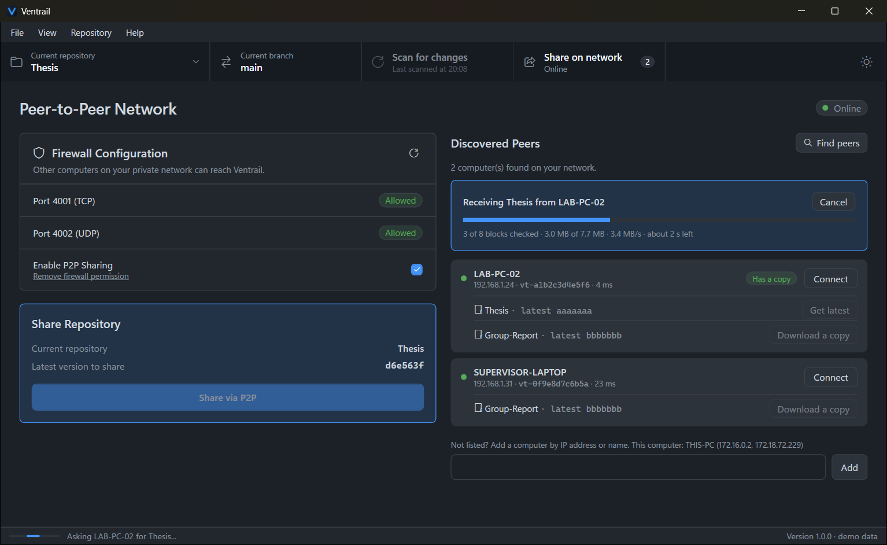

# Ventrail user guide

Ventrail keeps every version of your work, such as a thesis, design files or research data, so you
can always go back. It works **on your own computer**, needs **no account and no internet**, and
can share versions with other computers on the same network.

You don't need to know anything about Git. Ventrail uses it underneath.

---

## 1. Start

1. Unzip `Ventrail-1.0.0-win-x64.zip` anywhere (for example into *Documents*), or run the installer.
2. Double-click **Ventrail.exe**.
   - Windows may show *"Windows protected your PC"* the first time, because the app isn't from the
     Microsoft Store. Click **More info → Run anyway**.
3. To look around first with made-up files, use **Ventrail (demo data)** in the Start menu, or
   run `Ventrail.exe --demo`. Nothing on your PC is changed in demo mode.

### Finding your way around
If you've used GitHub Desktop, the layout will feel familiar:
- **Menu bar:** *File*, *View*, *Repository* and *Help*. Every action is also in a menu, with its
  keyboard shortcut next to it.
- **Toolbar** under the menu:
  - **Current repository ▾** switches between your recent folders, or opens a new one;
  - **Current branch** shows which line of history you're on;
  - **Scan for changes** looks for changed files again;
  - **Share on network** opens peer-to-peer sharing, with a badge for how many computers were found;
  - the **sun/moon** button on the far right switches between light and dark.
- **Left:** **Changes** and **History** tabs. **Right:** whatever you selected on the left.

### Light or dark
Click the sun/moon in the toolbar, or choose **View → Theme → Light**, **Dark** or **Match
Windows**. Ventrail remembers your choice.

## 2. Track a folder

- **Create a new repository** or **Add an existing repository** (File menu, the Welcome page, or
  **Current repository ▾**): pick the folder that holds your work. Ventrail starts keeping its
  history, and your files stay exactly where they are.
- Your recent folders are listed on the Welcome page and in **Current repository ▾**.
- Ventrail refuses whole drives or system folders (like `C:\` or `Windows`), so you never track
  far more than you meant to.

## 3. Save a version

1. The **Changes** tab lists every file that changed since the last version. The small square at
   the end of each row shows how it changed:
   - **+** added (new), **•** modified (changed), **−** deleted;
   - a **Heavy** badge marks a file that will make your history grow a lot (see 4).
2. Click a file to see **exactly which lines changed** on the right. **Expand** shows the
   comparison full-size; you can also double-click the file.
3. **Tick** the files you want in this version, or click **Tick all**.
4. At the bottom, write a short **Summary** (for example *"Finished chapter 3"*) and, if you like,
   a longer **Description**. Then click **Commit to main** (or press **Ctrl+Enter**).

**Discard** (above the comparison) throws away your unsaved changes to a file and goes back to
the last saved version. The current copy goes to the **Recycle Bin** first, so you can still get
it back.

## 4. The AI storage advisor

Ventrail includes a small AI model that runs entirely on your computer and never uploads anything.
- It marks **heavy** files: files whose every saved version adds a lot to your history (big
  images, videos, scans, archives).
- It explains each file's verdict above the comparison when you select the file.
- It suggests a **version message** for you, above the Summary box.
  - Click **Use suggestion** to use it, or **Write my own**.
  - **Why?** shows the storage advice behind the suggestion.
- For very large files it may suggest **leaving them out** of a version. Accepting unticks them;
  nothing is deleted.

## 5. Go back in time

- The **History** tab shows every saved version, newest first.
- Click a version to see its description (if one was written) and which files it contains.
- Select a file and click **Restore selected file** to bring that old copy back. History is
  never deleted: the restored file simply shows up as a new change that you can save.

## 6. Share with other computers (peer-to-peer)

Ventrail can send versions **directly** between computers on the **same network**, for example
home Wi-Fi or a phone hotspot. Nothing goes through the internet or the cloud.

### Allow sharing (once per computer)
1. Click **Share on network** in the toolbar (or press **Ctrl+3**).
2. Tick **Enable P2P Sharing**, or click **Share via P2P**.
3. Ventrail explains what it needs. Click **Allow**, then **Yes** on the Windows prompt.
   - This adds two Windows Firewall rules: only for Ventrail, only for its two ports, and only
     for devices on your local network.
   - You can undo it at any time with **Remove firewall permission**.

> **Tip:** if the page says your network is **Public**, Windows treats it like café Wi-Fi.
> On a network you trust, set it to **Private** in *Windows Settings → Network & internet*.

### Send a repository
- With your folder open, click **Share via P2P**. Ventrail tells computers nearby that you have it.

### Get a copy or the latest version

- **Discovered Peers** lists every computer running Ventrail with sharing on, each with the
  repositories it shares.
- **Download a copy** creates a new folder with the whole history and opens it.
  - You don't need a folder open first: use *"Get a repository from another computer"* on the
    Welcome page.
- **Get latest** updates the repository you already have to the other computer's newest version.
- Every 1 MB piece (block) is checked by its fingerprint (hash) as it arrives, so damaged data is
  never used. If you **Cancel**, or the connection drops, trying again continues where it stopped.

**Your work is never overwritten.**
- If you have unsaved changes, the new version is kept aside until you save or discard them.
- If you and the other person both saved different versions, theirs is kept separately and
  yours stays as it is.

### A computer doesn't show up?
- Check that Ventrail is open on both computers with sharing on, and that both are on the same
  network.
- Type the other computer's IP address or name into **Add** at the bottom of the peer list.
  Its name and IP address are shown at the bottom of its own Peer-to-Peer page
  (*"This computer: LAB-PC-02 (192.168.1.24)"*).
- Campus and café Wi-Fi often block devices from seeing each other. Use home Wi-Fi or a phone
  hotspot instead.

## 7. Keyboard shortcuts

| Keys | Does |
|---|---|
| **Ctrl+N** / **Ctrl+O** | Create a new repository / add an existing one |
| **Ctrl+1** / **Ctrl+2** / **Ctrl+3** | Changes / History / Peer-to-peer |
| **F5** | Scan for changes |
| **Ctrl+Enter** | Commit (in the Summary or Description box) |
| **Ctrl+Shift+F** | Show the repository in File Explorer |
| **F1** | Open this user guide |
| **Esc** | Close a dialog |

## 8. Good to know

- Ventrail's settings live in `%LocalAppData%\Ventrail`: your computer's peer id, recent folders,
  and versions waiting to be sent or received.
- Your history is stored in a hidden `.git` folder inside your project. **Don't delete it**, or
  your saved versions are gone. The folder also works with any normal Git tool.
- To uninstall, remove the program (or delete the unzipped folder). Your projects and their
  history are never touched.
